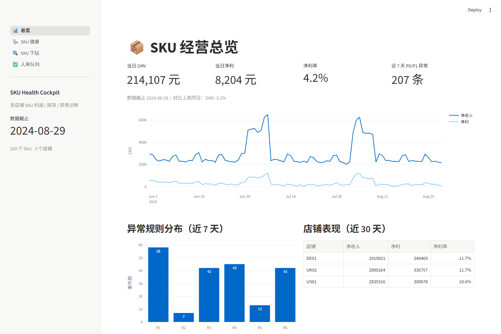
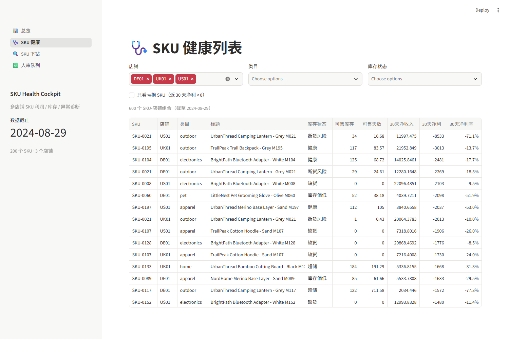
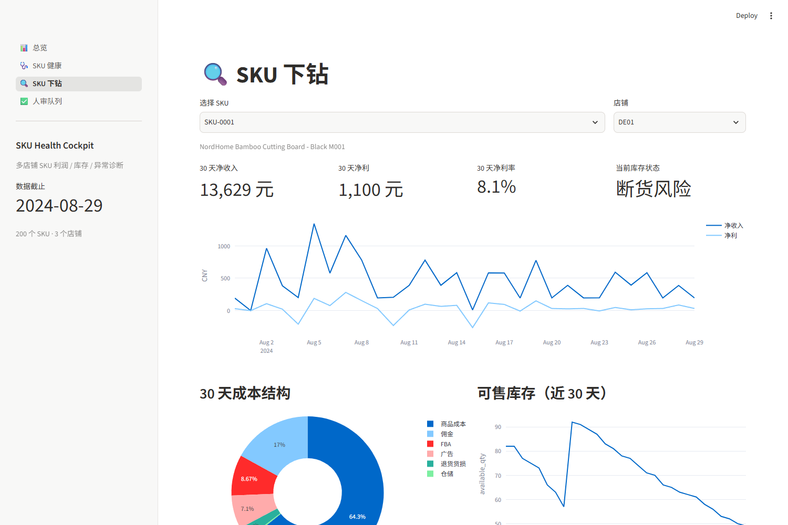
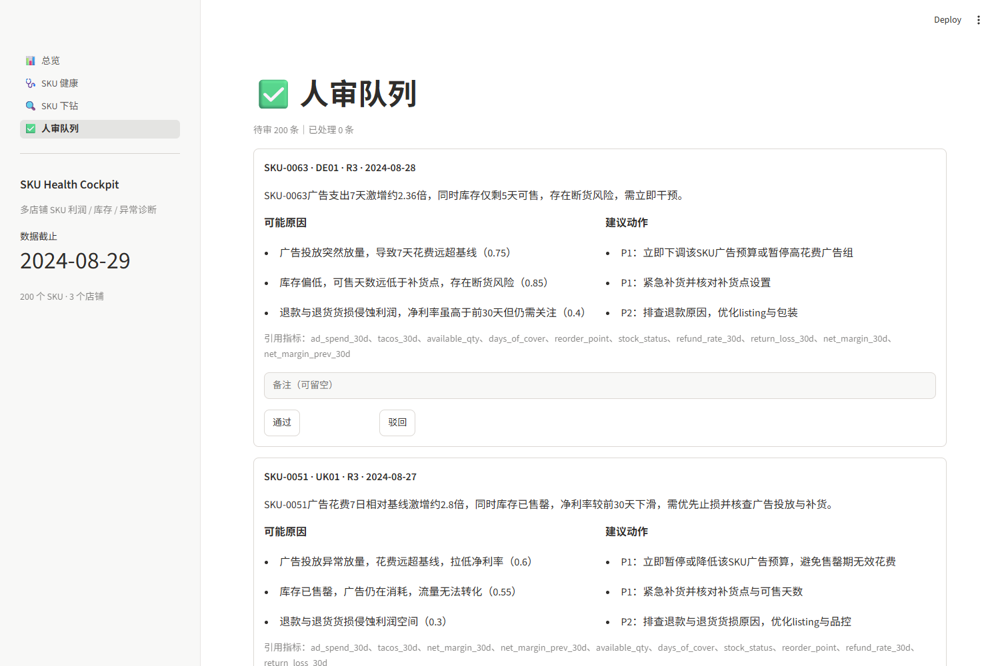

# SKU Health Cockpit

[](https://github.com/aazz2233/sku-health-cockpit/actions/workflows/ci.yml)

> 多店铺 SKU 利润、库存健康与异常诊断 —— 跨境电商内部工具演示
> Multi-store SKU profit / inventory health / anomaly diagnosis cockpit for cross-border e-commerce.

**30 秒看懂**：这是一个跨境电商运营的"体检台"。
3 个亚马逊店铺、200 个 SKU、9 万条订单导出成 30 多份格式各不相同的表格，
系统把它们清洗入库、算出每个 SKU 的真实利润与断货风险、自动挑出异常，
再让大模型解释"为什么亏"——但**模型不许碰数字，只能引用算好的指标**，最后人工拍板。

- 数据工程：8 类脏数据 100% 拦截并归因，重跑幂等
- 业务口径：毛利 40.9% / 净利 11.7%，三层对账（恒等式、Python 复算、结算单交叉）全过
- 异常识别：10 条可配置规则，注入的 81 个异常平均召回 **93%**
- AI 归因：200 条诊断，0 次降级、0 次引用校验失败，2.7 秒/条

把多个店铺、多种货币、表头各不相同的订单/退款/广告/库存/结算表格，
统一成一套口径，算出每个 SKU 的真实利润与断货风险，识别异常，
并让 AI 只负责"解释原因、给建议"，不确定时转人工复核。

## 核心设计

**规则算数，AI 解释，人来拍板。**

- 财务数字由规则引擎计算：可复现、可审计、零成本、不产生幻觉
- AI 只回答"为什么可能异常、接下来做什么"，且必须引用已算好的指标
- 每个结论都带证据（指标 + 窗口 + 数值），可追溯到原始行

## 界面

一条命令拉起：`. .\scripts\up.ps1`（缺数据会自动生成），或 `uv run streamlit run src/sku_cockpit/app/dashboard.py`

| 总览 | SKU 健康 |
| --- | --- |
|  |  |

| SKU 下钻 | 人审队列 |
| --- | --- |
|  |  |

## 当前进度

| 阶段 | 内容 | 状态 |
| --- | --- | --- |
| P0 | 工程骨架、CI、环境 | ✅ |
| P1 | 数据层：生成器 / 映射 / 校验 / 入库 / 质量报告 | ✅ |
| P2 | 指标层（利润、库存、KPI） | ✅ |
| P3 | 异常识别（10 条规则 + 评估） | ✅ |
| P4 | AI 归因 + 人审闭环 | ✅ |
| P5 | 看板 / 日报 / 交付脚本 | ✅ |

## 已跑出来的数据

一次 `generate + ingest`（seed=20241119）：

| 指标 | 值 |
| --- | --- |
| 规模 | 3 店 × 200 SKU × 90 天 |
| 订单行 | 82,134 |
| 总入库行 | 333,357 |
| 脏数据注入 | 15 行（8 类） |
| 脏数据召回 | **100%**（15/15，含原因码匹配） |
| 被拒行 | 16（多出 1 行是级联：坏订单行的退款成了孤儿） |
| 幂等 | 重跑 15 个文件全部 skip，行数不变 |
| 全量入库耗时 | ~21 秒 |

## 异常识别（P3）

10 条规则跑在 `mart_sku_daily` 上，用 P1 埋入的 81 条标注做评估：

| 规则 | 召回率 | 说明 |
| --- | ---: | --- |
| 销量断崖 / 广告失控 / 退款异常 / 超储 / 变体价差 / 断货风险 | 100% | |
| 持续负毛利 | 67% | 5 个未同时满足"低于 −4%"和"劣化 5pp" |

检测 6 秒 / 54,000 SKU-日。事件按区间存储，评估按区间重叠匹配。
详细规则、阈值推导和"为什么精确率不能直接引用"，见 [docs/rules.md](docs/rules.md)。

## AI 归因（P4）

对 7 日利润影响最大的 200 个 P0/P1 事件做解释，模型**只能引用已算好的指标**：

| 指标 | 值 |
| --- | ---: |
| 成功率 | 200 / 200（0 降级） |
| 引用校验失败 | 0 |
| 平均延迟 | 2.72 秒/条 |
| 总 token | 27 万输入 / 11 万输出 |

三道防线：指标白名单（模型看不到原始数据）→ 引用校验（编数字会被抓出来）→ 降级模板（宁可朴素也不给错的）。
设计与踩坑记录见 [docs/diagnosis.md](docs/diagnosis.md)。

## 快速开始

```powershell
# 一条命令：检查环境 → 按需生成数据 → 入库 → 指标 → 异常检测 → 日报 → 开看板
. .\scripts\up.ps1

# 或分步来
uv sync
uv run python -m sku_cockpit generate                 # 3 店 × 200 SKU × 90 天，约 6 秒
uv run python -m sku_cockpit ingest --drop --report   # 建表 + 入库 + 质量报告，约 21 秒
uv run python -m sku_cockpit metrics                  # 指标层，约 31 秒
uv run python -m sku_cockpit detect                   # 异常检测 + 评估，约 6 秒
uv run python -m sku_cockpit diagnose --limit 200     # AI 归因（需要 .env 里的 key）
uv run python -m sku_cockpit report-daily             # 日报 Markdown + Excel
uv run streamlit run src/sku_cockpit/app/dashboard.py # 看板
```

没有 MySQL 也能验证数据和规则：`uv run pytest` 里除 `integration` 标记外的用例都不依赖数据库。

数据库连接串放在 `.env`（`.env.example` 有模板），应用账号只对 `sku_cockpit` 库有权限。

## 目录

```
src/sku_cockpit/
├─ cli.py            generate / ingest / metrics / detect / diagnose / report-daily
├─ config.py         环境配置（pydantic-settings）
├─ schema.py         SQLAlchemy 表定义（维度 / 事实 / 暂存 / 控制 / 诊断）
├─ db.py             engine 与建表
├─ metrics.py        SQL 模板执行器（Jinja + 顺序执行 + 全量重算）
├─ anomaly.py        10 条异常规则 + 区间评估
├─ diagnosis.py      AI 归因：指标白名单 / 引用校验 / 降级
├─ report.py         日报（Markdown + Excel）
├─ app/dashboard.py  Streamlit 看板（4 页）
└─ data/
   ├─ constants.py   店铺、类目、促销日历等业务常量
   ├─ generator.py   带 seed 的模拟数据生成器（含异常与脏数据埋点）
   ├─ mapping.py     店铺表头 → 标准字段（YAML 驱动）
   ├─ validation.py  三档校验：结构 / 业务 / 统计
   ├─ ingest.py      raw → 校验 → staging，幂等
   └─ quality.py     质量报告与脏数据召回对照
sql/                 指标层 SQL（视图 + 三张 mart 表）
config/mapping/      每家店铺一份表头映射
config/rules.yaml    异常规则阈值
scripts/             up.ps1 一键启动、screenshots.py 截图
tests/               单元 + MySQL 集成测试
docs/                设计文档与看板截图
```

## 设计要点

**粒度用订单行。** 订单可多 SKU、可拆单、可部分退款，用订单粒度算不出 SKU 利润。

**金额一律 `DECIMAL(18,4)` + 显式币种。** 不用 float，汇率换算只有一个入口。

**时间存两份**：`*_at_utc` 和 `*_date_local`，报表按 marketplace 本地日切分。

**校验分三档**：结构 / 业务违规 → 拒绝并给原因码；统计离群 → 保留并打标（离群可能正是要找的异常）。

**坏数据不静默丢弃**：每行被拒都进 `reject_row`，带原因码、原始数据和源行号。

## 数据与合规

- 不接触任何真实经营数据；演示数据由带 seed 的生成器产生
- 不抓取需登录页面、不绕过反爬
- 密钥只走 `.env`，仓库里只有 `.env.example`

## 文档

- [环境说明](docs/environment.md)
- [数据层设计](docs/design-p1-data-layer.md)
- [指标口径](docs/metrics.md)
- [异常规则与评估](docs/rules.md)
- [AI 归因层](docs/diagnosis.md)
- [看板与日报](docs/dashboard.md)
- [如何展示这个项目](docs/showcase.md)

## License

MIT
